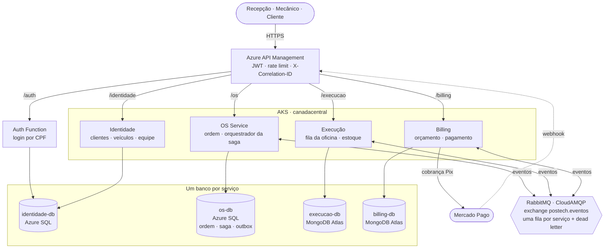
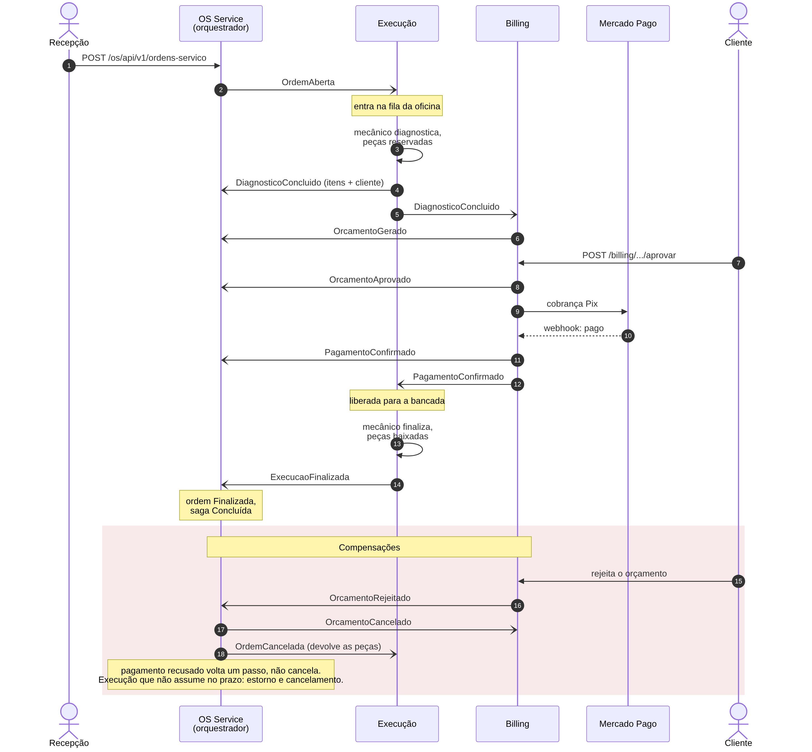
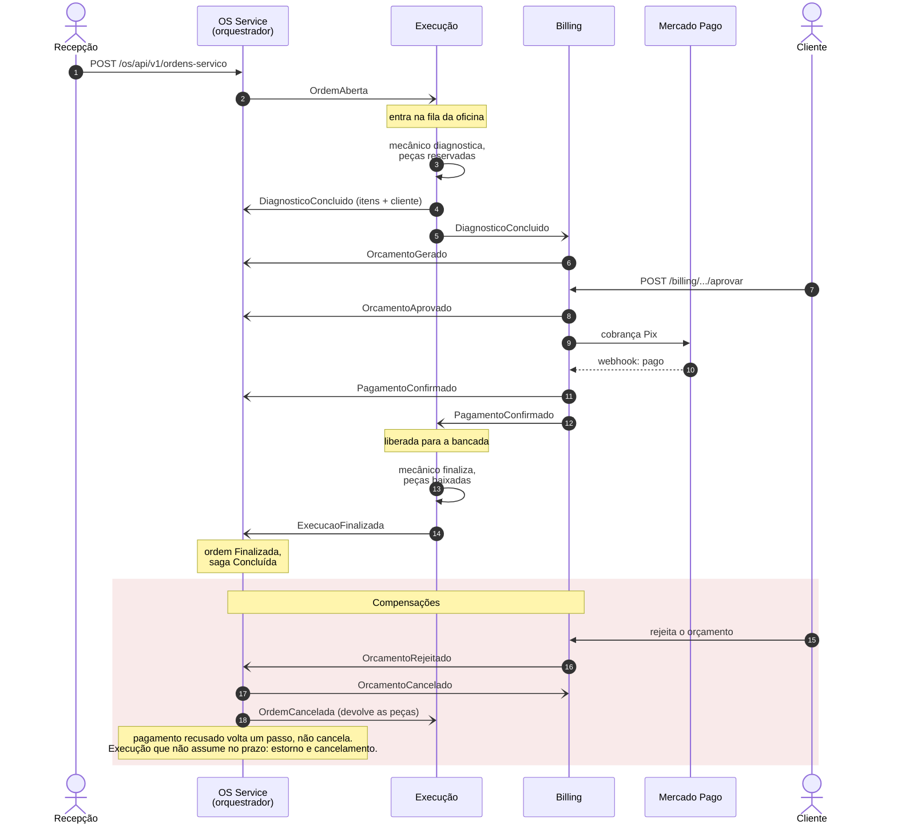

# Arquitetura da Fase 4

Visão de conjunto dos quatro microsserviços. É a mesma página nos quatro
repositórios; o README de cada um detalha o seu serviço.

## Componentes

Fora do desenho, para ele continuar legível: o **Key Vault** guarda todas as
connection strings e o segredo do JWT, e o Terraform os entrega aos pods; o
**Datadog** recebe traces e logs dos quatro serviços pelo agente no cluster.

### Quem fala com quem

| De → para | Como | Por quê |
| --- | --- | --- |
| Cliente → serviços | **REST síncrono**, pelo APIM | É uma requisição de usuário e precisa de resposta |
| Serviço → serviço | **Eventos no RabbitMQ**, nunca HTTP | Um serviço fora do ar não derruba o outro: o evento espera na fila |
| Serviço → banco | Só o **próprio** banco, com usuário próprio | Nenhum serviço acessa o banco de outro: a regra vale na credencial |
| Billing → Mercado Pago | REST, com chave de idempotência | Dois cliques em "pagar" não geram duas cobranças |
| Mercado Pago → Billing | Webhook pelo APIM, sem token | O Billing não confia na notificação: consulta o adquirente antes de agir |

### Bancos

| Serviço | Banco | Tipo | Por quê |
| --- | --- | --- | --- |
| OS | `os-db` | Azure SQL | A ordem, a saga e o outbox mudam na **mesma transação** |
| Identidade | `identidade-db` | Azure SQL | Unicidade de CPF, CNPJ e placa garantida por índice; o login depende dela |
| Billing | `billing-db` | MongoDB | O orçamento é lido e escrito inteiro; o outbox mora dentro do documento |
| Execução | `execucao-db` | MongoDB | A ordem na oficina é um documento com os itens dentro; reserva de peça atômica por documento |

Detalhes em [ADR-0007](ADR-0007-banco-por-servico.md).

## A saga

Orquestrada pelo OS Service ([ADR-0006](ADR-0006-saga-orquestrada.md)). Cada
seta é um evento atravessando o RabbitMQ; o orquestrador decide o passo
seguinte e, quando algo falha, a compensação.

| Falha | O que a saga faz |
| --- | --- |
| Orçamento rejeitado | Cancela o orçamento e a ordem; o Execução devolve as peças |
| Pagamento recusado | **Volta um passo**: o orçamento continua valendo e o cliente tenta de novo |
| Execução não assume no prazo | O varredor do OS cancela; o Billing estorna; a saga só fecha quando o estorno confirma |
| Falha ao publicar | Nenhuma: o evento fica no outbox e é reenviado |

A regra que organiza todas: **compensar só o que de fato aconteceu**. O fluxo
completo, com as compensações, está especificado em BDD em
[`tests/PosTech.Os.Testes/Bdd`](https://github.com/Gustavollier/postech-os-service/tree/main/tests/PosTech.Os.Testes/Bdd).

Para percorrer esse fluxo de verdade, pelo gateway: [coleção do Postman](https://github.com/Gustavollier/postech-os-service/blob/main/docs/postman/PosTech-Fase4.postman_collection.json).

## Garantias de entrega

| Problema | Solução |
| --- | --- |
| Gravar no banco e publicar no broker não cabem numa transação | **Outbox transacional**: o evento é gravado junto com a mudança e publicado depois, por um processo à parte |
| O broker entrega ao menos uma vez | **Idempotência** por `MensagemId` em cada consumidor |
| Mensagem que nunca vai dar certo | Três tentativas, depois **dead letter**, onde fica visível |
| Seguir uma ordem pelos quatro serviços | `X-Correlation-ID` criado no APIM e propagado em todo evento |

## Repositórios

| Repositório | Conteúdo |
| --- | --- |
| [postech-os-service](https://github.com/Gustavollier/postech-os-service) | OS Service e o orquestrador da saga |
| [postech-billing-service](https://github.com/Gustavollier/postech-billing-service) | Billing Service |
| [postech-execucao-service](https://github.com/Gustavollier/postech-execucao-service) | Execução Service |
| [postech-identidade-service](https://github.com/Gustavollier/postech-identidade-service) | Identidade Service |
| [postech-infra-db](https://github.com/Gustavollier/postech-infra-db) | Terraform do Azure SQL e do Key Vault |
| [postech-infra-k8s](https://github.com/Gustavollier/postech-infra-k8s) | Terraform do AKS, ACR, APIM, Auth Function e Datadog |
| [postech-auth-function](https://github.com/Gustavollier/postech-auth-function) | Login do cliente por CPF |
